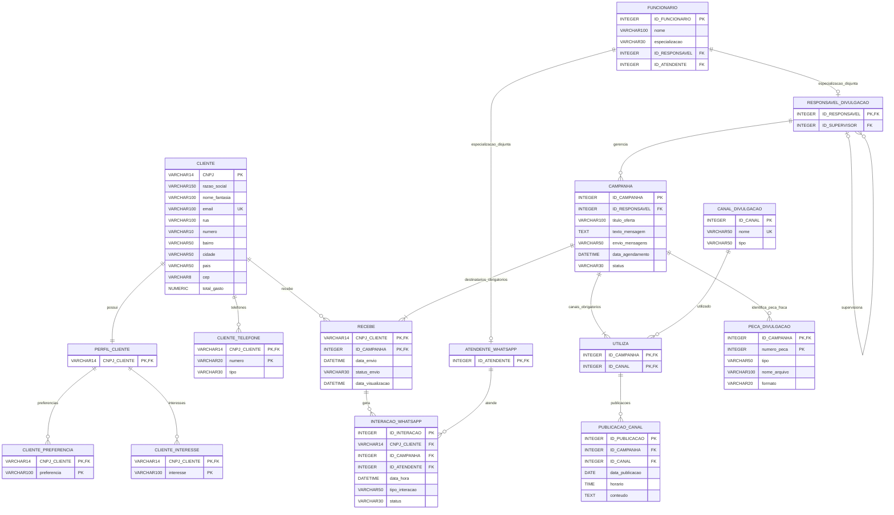

# RSouza — Campanhas e relacionamento com garagens de ônibus

Aplicação acadêmica da A R Souza Auto Peças com **React + CSS, Node.js/Express e SQLite**, refatorada conforme o **dicionário de dados e o texto do Modelo Descritivo fornecidos em 01/11/2026**, com as conciliações expressamente aprovadas. A imagem do MER ainda não foi disponibilizada; o diagrama abaixo representa a implementação do texto fornecido.

**WhatsApp demonstrativo:** não há integração com a Meta nem disparo real. `RECEBE.status_envio = Enviado` significa exclusivamente **simulado**, como indicado nas telas. Publicações, interações e visualizações são demonstrativas. Visualização e atendimento são registrados manualmente, nunca inferidos automaticamente. O botão WhatsApp apenas prepara um texto; não envie mensagens aos números fictícios.

## Executar

Requisito: **Node.js 22.13 ou superior**, com `node:sqlite` nativo. Também compatível com Node 26.

```sh
npm ci
npm run server
```

Em outro terminal:

```sh
npm run dev
```

Acesse **http://127.0.0.1:5173**. Credenciais exclusivamente demonstrativas de desenvolvimento: **admin / Demo@2026!**.

Na primeira execução, o SQLite é criado em `data/rsouza.sqlite` com empresas, CNPJs com dígitos verificadores válidos, telefones, gastos e funcionários **todos fictícios**, além de canais, uma campanha e uma peça. CNPJ válido sintaticamente não significa empresa real. Os e-mails usam `example.invalid`.

### Versão compilada

Copie `.env.example` para `.env`; defina `ADMIN_PASSWORD` e `SESSION_SECRET` próprios. Um segredo pode ser gerado com `node -e "console.log(require('crypto').randomBytes(32).toString('hex'))"`.

```sh
npm run build
npm start
```

Acesse **http://127.0.0.1:3001**. `PORT`, `DATABASE_PATH`, `ADMIN_USER`, `COMPANY_NAME` e `COOKIE_SECURE` são configuráveis. O servidor escuta em `127.0.0.1`. `COOKIE_SECURE=true` exige HTTPS; deixe `false` na apresentação local HTTP. `.env`, bancos e backups em `data/` não são versionados. Implantação pública e integração comercial não fazem parte da entrega.

## Telas e fluxo

| Tela | Função |
| --- | --- |
| Login | Sessão administrativa de oito horas, limite de tentativas e logout |
| Visão geral | Quantidade de empresas, campanhas, recebimentos simulados e interações |
| Clientes e perfis | CNPJ imutável, razão social, nome fantasia, e-mail único, endereço composto, gastos demonstrativos, vários telefones, interesses e preferências |
| Funcionários | Cadastro de responsável ou atendente; supervisor opcional de responsáveis |
| Campanhas | Responsável obrigatório, oferta, mensagem, status Ativo/Inativo, seleção de clientes e canais, agendamento, cancelamento e simulação |
| Canais | Cadastro dos canais de divulgação; ligação N:N por UTILIZA |
| Peças de divulgação | Metadados do arquivo, tipo e formato PDF/PNG/MP4; chave composta campanha + número |
| Publicações | Campanha, canal utilizado, conteúdo, data e horário UTC |
| Recebimentos | Relação cliente/campanha, status de simulação, data de envio, visualização manual opcional e WhatsApp manual |
| Interações WhatsApp | Várias interações por cliente/campanha, atendente obrigatório, data/hora, tipo e status |
| Banco de dados | Consulta somente leitura das quinze tabelas, chaves e vinte registros mais recentes |

**Segmentação:** filtre por interesse, preferência, gasto mínimo e máximo. Todos os critérios preenchidos são combinados com **E**, o texto é comparado por igualdade sem distinguir maiúsculas/minúsculas, e os limites de gasto são inclusivos. Na campanha, clique em **Selecionar público pelos filtros**, confira a lista e salve. Também pode selecionar empresas individualmente.

A seleção é persistida em `RECEBE` como `Pendente` na criação da campanha; os critérios não são colunas de CAMPANHA. Alterar o perfil ou gasto depois não muda os destinatários já selecionados. Uma campanha deve possuir ao menos um cliente e um canal, inclusive em rascunho; a API grava esses vínculos atomicamente e bloqueia seleção vazia.

O agendador verifica campanhas `Ativo` + `Agendada` a cada dez segundos, com o servidor ligado, e processa agendamentos vencidos ao reiniciar. A execução transacional marca RECEBE como Enviado, registra o momento simulado e cria uma PUBLICACAO_CANAL por canal utilizado. `envio_mensagens` passa a `Simulada`, evitando reexecução. Uma falha é registrada explicitamente e não impede outras campanhas de serem processadas.

Campanhas simuladas e suas peças são imutáveis. Para excluir uma campanha agendada, cancele primeiro. Clientes, funcionários e canais com vínculos não podem ser excluídos. Um cliente não pode ficar sem perfil; o perfil é criado junto com ele e excluído em cascata quando a exclusão do cliente for permitida. Especialização e identidade do funcionário não podem ser trocadas; a hierarquia de supervisão não aceita ciclos.

## Conciliação do dicionário com o MER

As divergências abaixo foram identificadas e a solução foi aprovada pelo usuário:

| Ponto | Implementação |
| --- | --- |
| FUNCIONARIO e PERFIL_CLIENTE estão no MER, mas ausentes do dicionário | Incluídos. PERFIL_CLIENTE usa o CNPJ do cliente como PK/FK 1:1. FUNCIONARIO possui ID, nome e discriminador operacional de especialização. |
| Especialização total e disjunta | Identidade compartilhada entre FUNCIONARIO e seu único subtipo, FKs diferidas, CHECKs e triggers. IDs dos subtipos são os IDs do funcionário, não sequências independentes. |
| CEP aparece no texto do MER, país apenas no dicionário | Ambos incluídos. CEP opcional com oito dígitos; país opcional com default Brasil. |
| Total_Gasto é derivado no MER, sem entidade de histórico comercial | `total_gasto NUMERIC` informado para demonstração, não calculado de vendas. Não foi inventada tabela de vendas. Limite 999.999.999,99, não negativo, duas casas decimais. |
| CAMPANHA tem Texto_Mensagem no MER e envio_mensagens no dicionário | Ambos mantidos. `texto_mensagem TEXT` obrigatório, limitado a 4.000 caracteres; `envio_mensagens VARCHAR(50)` guarda Rascunho/Agendada/Simulada/Cancelada. |
| CAMPANHA.status no dicionário | Mantido como **Ativo/Inativo**, default Ativo. O estado de execução não ocupa esse atributo. |
| data_agendamento DATE, mas agendamento exige horário | `DATETIME` com ISO UTC e milissegundos. A tela converte o horário local para UTC. Publicações mantêm DATE + TIME separados, em UTC. |
| Chaves multivaloradas não especificadas | PKs compostas CNPJ + número/interesse/preferência; RECEBE usa CNPJ + ID_CAMPANHA. |
| numero_peca aparece único no dicionário, mas é chave parcial no MER | Unicidade por campanha: PK **(ID_CAMPANHA, numero_peca)**. O mesmo número é permitido em campanhas diferentes. |
| UTILIZA N:N no MER | Tabela de ligação **(ID_CAMPANHA, ID_CANAL)**; PUBLICACAO_CANAL referencia esse par, garantindo que a publicação use um canal da campanha. |
| Atendimento opcional no texto, obrigatório no dicionário | `ID_ATENDENTE` obrigatório nas interações, conforme conciliação aprovada. A interação é registrada quando há atendimento manual. |
| Envios/visualizações no modo demonstrativo | Enviado/Pendente mantidos no banco, sempre rotulados como simulação. Não há visualização automática. |

No SQLite, `VARCHAR(n)` e `INT(11)` não funcionam como no MySQL: limites textuais, enums, relações e nulidade são aplicados por constraints e validação da API. IDs são `INTEGER PRIMARY KEY AUTOINCREMENT`. CNPJ tem formato validado no banco e dígitos verificadores validados pela API. A API garante o mínimo de um destinatário e um canal por campanha em suas transações; SQLite não possui assertions diferidas para cardinalidade mínima de tabelas de ligação. Escrita SQL manual fora da API deve respeitar essa regra.

Os campos `consent`, `active`, `segment_id`, `notes` e snapshots de mensagens do modelo anterior **não foram acrescentados ao novo dicionário**. Antes de qualquer envio manual a contatos reais, obtenha autorização; preferir WhatsApp não equivale a consentimento. O novo sistema é demonstrativo e não toma decisões de disparo comercial.

## Modelo entidade-relacionamento implementado



Os dois relacionamentos opcionais de especialização no diagrama devem ser lidos em conjunto: **exatamente um** subtipo por funcionário. A FK recíproca cliente/perfil é diferida para permitir criar o par obrigatório em uma única transação.

## Migração do banco anterior

Ao abrir um banco com `clients`, `segments`, `materials`, `campaigns` e `deliveries`, o servidor detecta o modelo antigo e:

1. Gera **backup SQLite integral** por `VACUUM INTO` e exportação JSON, ao lado do banco, com sufixo `.before-mer-<data>.sqlite`.
2. Cria o novo esquema e migra os registros em uma transação. CNPJs com dígitos válidos e e-mails fictícios são gerados a partir dos IDs antigos; gasto inicial zero. O nome do segmento antigo vira um interesse do perfil.
3. Transfere a mensagem do material para CAMPANHA, mantém os destinatários dos históricos e registra respostas com atendente de migração fictício. Cria publicações demonstrativas para históricos existentes. Campanhas futuras mantêm a seleção dos clientes anteriormente ativos e autorizados.
4. Remove as cinco tabelas antigas somente após converter tudo com sucesso; grava `PRAGMA user_version=2`. Reiniciar não repete a migração.

Os dados antigos sem equivalência (consentimento, ativo, observações, snapshots de mensagens, imagens e materiais independentes) ficam **integralmente no backup JSON/SQLite**, não em campos inventados no novo modelo. CNPJs gerados precisam ser substituídos por dados corretos antes de qualquer uso real; a aplicação atual destina-se à demonstração.

Se uma campanha antiga não possui público válido ou seu título excede o limite novo, a migração falha explicitamente, desfaz a transação e preserva o banco antigo e backup. Corrija a incompatibilidade no banco antigo com o servidor parado e tente novamente. **Não apague o banco para “resolver” migração.** Faça novo login ao reiniciar; as sessões não são persistidas.

## API, verificação e evidências

Rotas autenticadas principais: `/api/clients`, `/api/employees`, `/api/campaigns`, `/api/channels`, `/api/pieces`, `/api/publications`, `/api/receives`, `/api/interactions`, `/api/dashboard` e `/api/database`. As rotas de segmentos, materiais e entregas antigas foram removidas.

Clientes e perfis são salvos juntos; telefones/interesses/preferências são listas. A campanha aceita listas `clientes` (CNPJs) e `canais` (IDs), ou `filtros` para obter o público diretamente na API. Peças usam `/api/pieces/:campanha/:numero`; visualizações, `/api/receives/:campanha/:cnpj`.

```sh
npm test
npm run build
npm run db:inspect
```

O banco pode ser aberto no DB Browser for SQLite. Testes cobrem migração com backup e rollback, especialização, perfil obrigatório, chaves compostas, unicidade, limites de campos, segmentação, atendimento, agendamento real e persistência. Evidências atualizadas e roteiro estão em [`docs/evidencias`](docs/evidencias).

Estrutura: `src/` contém interface/CSS, `server/database.js` esquema/migração/agendador, `server/app.js` API/autenticação, `server/validation.js` validação, `server/inspect.js` consulta somente leitura e `tests/` verificação automatizada.

Não há histórico comercial, cálculo real de gastos, upload/download de peças, robô, API oficial, confirmação de leitura, webhook ou entrega física de peças. Informe o uso de IA conforme as regras da disciplina e confira o diagrama com a imagem original do MER quando ela estiver disponível.
