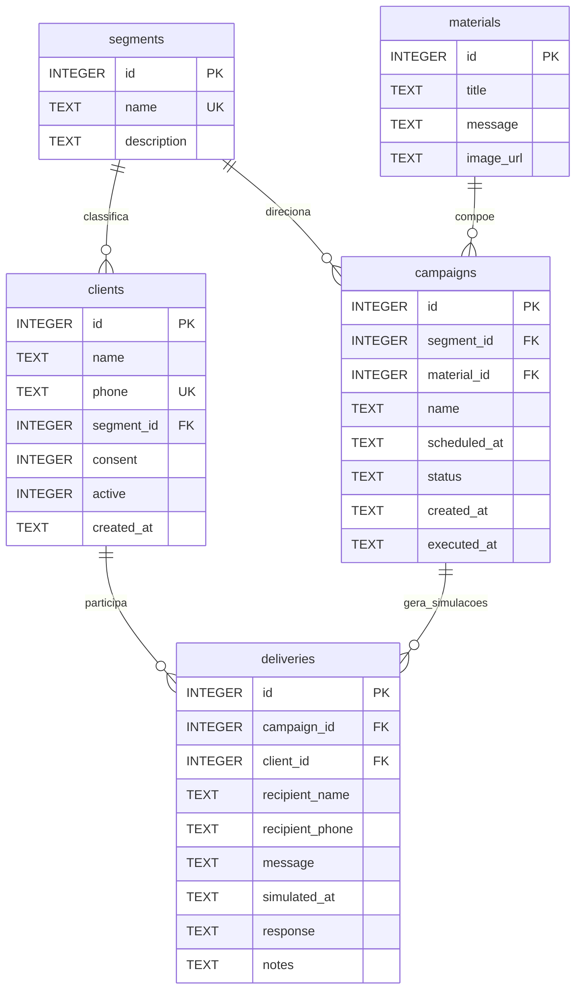

# RSouza — Central de campanhas promocionais

Aplicação acadêmica para a **A R Souza Auto Peças**, com React + CSS, API Node.js/Express e banco relacional SQLite. O foco é organizar campanhas promocionais segmentadas, seu agendamento e o acompanhamento manual das respostas.

**Modo demonstrativo:** o sistema não integra a API da Meta, não envia mensagens automaticamente e não comprova envio, entrega ou leitura. O agendador cria registros explicitamente simulados. O botão WhatsApp apenas abre uma conversa com texto preenchido; o usuário precisa confirmar o envio. Não envie mensagens aos telefones fictícios fornecidos.

## Executar localmente

Requisito: **Node.js 22.13 ou superior**, com suporte ao módulo nativo `node:sqlite`. A versão 26 também é compatível. Um aviso de SQLite experimental pode aparecer em algumas versões.

```sh
npm ci
npm run server
```

Em outro terminal, no mesmo diretório:

```sh
npm run dev
```

Abra **http://127.0.0.1:5173**. Login exclusivamente demonstrativo de desenvolvimento: **admin / Demo@2026!**. O banco é criado e preenchido na primeira inicialização em `data/rsouza.sqlite`. Os dados persistem ao reiniciar e não são enviados ao GitHub.

### Executar a versão compilada

Copie `.env.example` para `.env` e defina `ADMIN_PASSWORD` (senha própria) e `SESSION_SECRET` (valor aleatório, por exemplo gerado por `node -e "console.log(require('crypto').randomBytes(32).toString('hex'))"`).

```sh
npm run build
npm start
```

Abra **http://127.0.0.1:3001**. `.env` não deve ser versionado. `COMPANY_NAME`, `ADMIN_USER`, `DATABASE_PATH` e `PORT` são configuráveis. `COOKIE_SECURE=true` exige HTTPS; deixe `false` na demonstração local HTTP. O servidor escuta somente em loopback por padrão; exposição pública exige configuração de implantação adequada, HTTPS e revisão de segurança, não incluídas nesta entrega.

## Funcionalidades e telas

| Tela | Funcionalidades |
| --- | --- |
| Login | Autenticação administrativa, limite de tentativas e sessão de oito horas |
| Visão geral | Totais de clientes, campanhas, simulações e interessados |
| Clientes | Cadastro, edição, exclusão, busca, segmento, ativo/inativo e consentimento |
| Segmentos | Cadastro, edição, exclusão e quantidade de clientes vinculados |
| Materiais | Mensagem promocional, personalização com `{nome}` e link HTTPS opcional de imagem |
| Campanhas | Rascunho, edição, agendamento, cancelamento e simulação imediata |
| Atendimento | Histórico por destinatário, filtros, resposta e observação manuais, link WhatsApp |
| Banco de dados | Consulta somente leitura de todas as tabelas, chaves e dados persistidos |

O agendador roda a cada dez segundos **enquanto o servidor está ligado**. Na inicialização, processa agendamentos vencidos. A interface atualiza os dados a cada quinze segundos ou pelo botão Atualizar. Apenas clientes **ativos, com consentimento e pertencentes ao segmento da campanha** participam. Uma campanha é executada no máximo uma vez; nenhuma seleção de destinatários significa uma simulação concluída com zero registros.

As mensagens e os dados do destinatário ficam registrados como fotografia do momento da simulação. Alterações posteriores no material não alteram o histórico. Campanhas concluídas não podem ser editadas ou excluídas. Exclusões com vínculos são bloqueadas; desative um cliente para preservar o histórico. Retirar o consentimento ou desativar o cliente também oculta o botão de contato manual no atendimento.

## Banco relacional



`deliveries` representa **registros de simulação de campanhas**, não o processo de entrega física de peças. Chaves estrangeiras, restrições de situação/consentimento e unicidade de campanha + cliente são aplicadas no banco. Datas são armazenadas em UTC e exibidas no horário local do navegador.

Para consultar o banco:

```sh
npm run db:inspect
npm test
```

Também é possível abrir `data/rsouza.sqlite` no DB Browser for SQLite ou usar a tela **Banco de dados** da aplicação.

## Relação com o trabalho interdisciplinar

A implementação segue o resumo das atividades fornecido na conversa: cadastro e segmentação de clientes, preparação de materiais, campanhas agendadas, registros de envio e acompanhamento das respostas. O processo de entregas físicas/entregador terceirizado fica fora deste escopo.

**Os PDFs e o DER original não estavam disponíveis na sessão de implementação.** Portanto, o modelo acima é o modelo implementado, não uma transcrição conferida dos documentos. Compare com os arquivos originais antes da entrega e declare o uso de IA conforme as regras da disciplina.

## Evidências e apresentação

As capturas e o roteiro de apresentação ficam em [`docs/evidencias`](docs/evidencias). São telas do sistema realmente executado com dados fictícios. Registros de campanhas exibidos nessas evidências são simulações, não envios reais de WhatsApp.

## Estrutura

```text
src/                  Interface React e CSS responsivo
server/app.js         API, autenticação e validação
server/database.js    Tabelas, dados fictícios e execução transacional
server/index.js       Inicialização e agendador
server/inspect.js     Consulta somente leitura para evidências
tests/                Testes automatizados da API e persistência
docs/evidencias/      Capturas reais e roteiro
```

Não há serviço externo, robô, disparo em massa, upload de arquivos ou integração comercial. As respostas são informadas por um operador, não recebidas por webhook. A URL de imagem vira um link no texto. A sessão administrativa fica em memória e exige novo login após reinício do servidor.